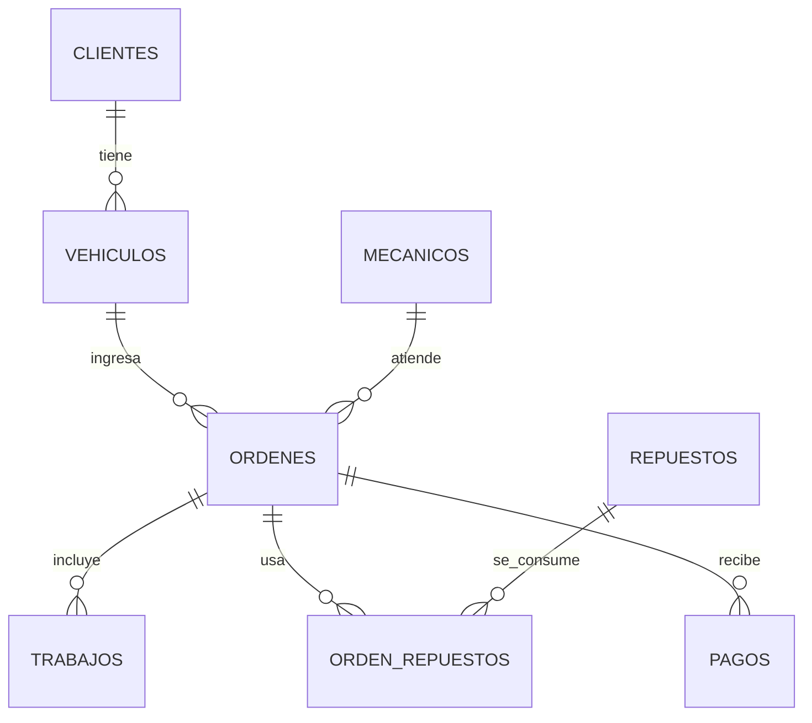

# El Pistón · Gestión de taller automotriz

App móvil (Flutter) para llevar el trabajo diario de un taller mecánico **sin conexión**. Toda la información se guarda en una base SQLite local con **Drift**, por lo que sobrevive al cierre y reinicio de la aplicación.

Asignatura: Programación para Dispositivos Móviles · Actividad individual (Drift).

## Cómo ejecutar
```bash
flutter create .                       # genera android/ios (solo la primera vez)
flutter pub get
dart run build_runner build --delete-conflicting-outputs   # genera database.g.dart
flutter run
```

## Stack
- Flutter + Material 3
- **Drift** (`drift`, `drift_flutter`) para persistencia local
- `provider` solo para inyectar la base de datos; la UI se actualiza con streams reactivos de Drift (`watch()`), sin estado duplicado.

## Modelo de datos

| Tabla | Campos principales |
|---|---|
| clientes | nombre, teléfono, dirección (opcional) |
| vehiculos | cliente, matrícula (única), marca, modelo, año, km última visita |
| mecanicos | nombre (2 precargados, renombrables) |
| ordenes | vehículo, mecánico, fecha de entrada, problema, estado, km de ingreso |
| trabajos | orden, descripción, precio de mano de obra |
| repuestos | nombre, código (único), precio, existencias (≥ 0), stock mínimo |
| orden_repuestos | orden, repuesto, cantidad, **precio unitario al momento** |
| pagos | orden, monto, fecha |

## Decisiones de diseño
- **Un cliente → varios vehículos → varias órdenes**: el historial de un cliente o vehículo es simplemente filtrar órdenes.
- **Estado como enum** (`recibida, en diagnóstico, en reparación, lista para entregar, entregada, cancelada`) guardado con `textEnum`. *Abierta* = no entregada ni cancelada. Una orden cerrada no admite cambios de trabajos/repuestos, pero una *entregada* sí admite pagos (cliente que paga en dos partes).
- **Total y saldo no se almacenan, se calculan** (mano de obra + repuestos − pagos) con una consulta SQL, para evitar inconsistencias. Los pagos no pueden superar el saldo.
- **Precio del repuesto congelado** en `orden_repuestos`: cambiar el precio del inventario no altera órdenes anteriores.
- **Inventario consistente con transacciones**: usar un repuesto descuenta existencias y registra el uso en una sola `transaction`; si no alcanza el stock se rechaza. Quitar un repuesto o **cancelar la orden** devuelve las existencias. Además hay un `CHECK (existencias >= 0)`.
- **Alerta de stock**: un repuesto está “por agotarse” si `existencias <= stockMínimo` (por defecto 3, editable). Se avisa con un SnackBar al usarlo, en el panel de inicio y con banner/marcas en el inventario.
- **Kilometraje**: al crear una orden se actualiza el km del vehículo (“km con el que llegó la última vez”).
- **Facturado en un período** = suma del total de las órdenes no canceladas con fecha de entrada dentro del rango; se muestra también lo cobrado y lo pendiente.
- **Moneda**: se muestra con `$` y 2 decimales (supuesto razonable ante contexto abierto).
- **Integridad**: claves foráneas activadas (`PRAGMA foreign_keys = ON`), matrícula y código únicos con mensajes claros.

## Pantallas
1. **Inicio**: órdenes abiertas por estado, carga por mecánico, repuestos por agotarse.
2. **Órdenes**: lista con búsqueda y filtros por estado, creación guiada, detalle (cambio de estado, trabajos, repuestos, pagos, totales).
3. **Clientes**: lista con búsqueda; detalle con vehículos, deuda e historial. **Vehículo**: historial y nueva orden directa.
4. **Inventario**: alta/edición, reposición rápida, resaltado de stock bajo.
5. **Reportes**: facturación por rango de fechas y clientes con saldo pendiente.

## Experiencia de usuario
Navegación inferior, buscadores, filtros por chips, formularios con validación, estados vacíos explicativos, colores por estado, confirmación al cancelar, mensajes de error de negocio y totales siempre visibles en la orden.

## Limitaciones
No hay borrado de clientes/vehículos (para conservar el historial) ni edición de pagos.

## Capturas
Ver carpeta [`capturas/`](capturas/).
